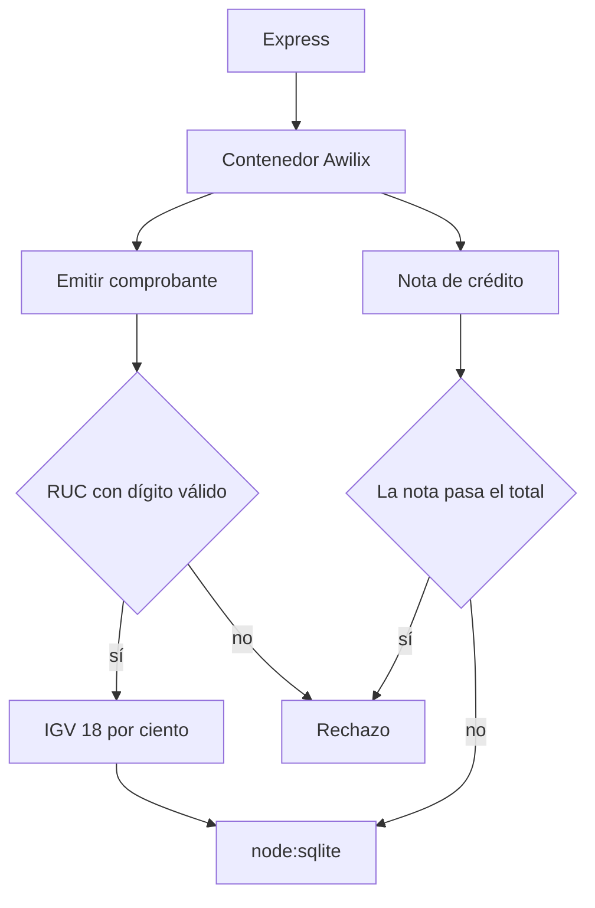

# Comprobantes

La emisión de una factura y de su nota de crédito. El IGV es 18 %, el RUC lleva el dígito de SUNAT y la nota no puede anular más de lo vendido.

## Concepto

Los montos viven en céntimos. El dominio calcula el total y valida el RUC. La nota de crédito resta, y se detiene si pasa el total del comprobante. Express no instancia el dominio a mano: Awilix, en `composition.ts`, es el único lugar que une repositorio y casos de uso.

## Stack

| Pieza | Para qué |
| --- | --- |
| Node.js | Runtime y `node:sqlite`. |
| Express | HTTP en el puerto `3044`. |
| Awilix | Inyección de dependencias, modo proxy. |
| Arquitectura hexagonal | El repositorio es un puerto. SQLite y Express son adaptadores. |
| Clean Architecture | Totales, RUC y el tope de la nota viven en el dominio. |
| TypeScript | Fuentes y `tsc`. |
| node:test | `tsx --test` cubre dominio y HTTP. |

## Flujo



## Correr

Desde esta carpeta:

```bash
npm ci
npm test
npm run dev
```
